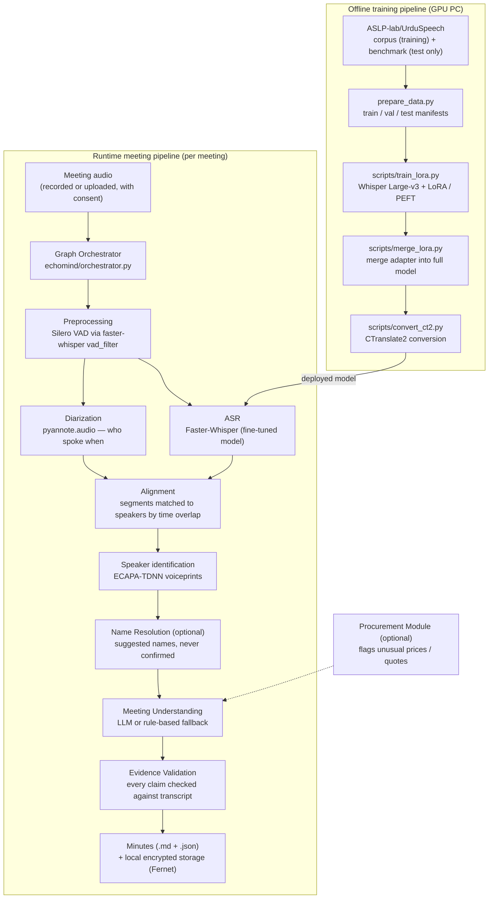

# EchoMind — System Architecture

**Project:** EchoMind — local, privacy-first meeting intelligence for Urdu / English code-switched meetings
**Author:** Taha Mehmood, BS Data Science (Final Year Project)
**Repository:** tahaha7/FYP-1

---

## 1. Overview

Meetings in Pakistan routinely switch between Urdu and English within a
single sentence. General-purpose transcription services handle this
code-switching poorly, and cloud services require sending sensitive meeting
audio to third-party servers. EchoMind addresses both problems: it
fine-tunes OpenAI's Whisper Large-v3 on Urdu and Urdu–English code-switched
speech, and it runs the entire meeting pipeline — transcription, speaker
diarization, speaker identification, and meeting understanding — locally,
with all records stored encrypted on the user's own machine.

The system has two halves:

1. **An offline training pipeline** that downloads the UrduSpeech dataset,
   prepares training manifests, fine-tunes Whisper Large-v3 with LoRA, and
   converts the result into the fast Faster-Whisper (CTranslate2) format.
2. **A runtime meeting pipeline** that takes one meeting recording and
   produces a speaker-attributed transcript plus verified minutes
   (summary, decisions, action items), stored locally in encrypted form.

A plain-Python orchestrator controls the runtime pipeline. Each step is
run through a retry helper (two attempts per step), and the status of
every step is recorded in the output, so a failed step is visible rather
than silent.

---

## 2. Architecture diagram

---

## 3. Component map

Every component from the original project specification, where it lives in
the code, and its honest implementation status.

| # | Specification item | Where it lives | Status |
|---|---|---|---|
| 1 | Whisper Large-v3 (OpenAI) — core ASR model | Base model in `scripts/train_lora.py`; stock model also runnable via `echomind/transcribe.py` / `echomind/evaluate_asr.py` | Implemented — fine-tuning and Large-v3 inference are GPU jobs |
| 2 | Faster-Whisper — fast inference / deployment | `echomind/transcribe.py` (used by the orchestrator and the evaluator) | Implemented |
| 3 | CTranslate2 — conversion to Faster-Whisper format | `scripts/convert_ct2.py`, with `scripts/merge_lora.py` before it (the converter needs a full model, not an adapter) | Implemented |
| 4 | pyannote.audio — speaker diarization | `echomind/diarize.py` (`pyannote/speaker-diarization-3.1`) | Implemented — requires a GPU for practical use and an `HF_TOKEN` (the model is gated on Hugging Face). If unavailable, the pipeline falls back to a single `SPEAKER_00` label and records this in its status |
| 5 | NVIDIA NeMo Sortformer — backup diarization | Documented in `config.yaml` and the README as the fallback option for difficult audio | Documented only — not implemented in Phase 1 |
| 6 | Silero-VAD — voice activity detection | Built into Faster-Whisper; enabled as `vad_filter=True` in `echomind/transcribe.py` | Implemented |
| 7 | DeepFilterNet / RNNoise — denoising | Not present in the code | Optional — not in Phase 1. Preprocessing currently relies on VAD only; denoising is added only if real meeting recordings show it is needed |
| 8 | ECAPA-TDNN — speaker identification ("voice fingerprints") | `echomind/speaker_id.py` (SpeechBrain `speechbrain/spkrec-ecapa-voxceleb`): enrolment stores a normalised embedding, identification compares cosine similarity against the threshold in `config.yaml` (0.35) | Implemented as a module — GPU-oriented. Wiring per-speaker identification into the orchestrator output is a next-phase item; Phase 1 minutes keep diarization labels |
| 9 | Transformers / PyTorch — training framework | `scripts/train_lora.py`, `scripts/merge_lora.py` | Implemented — GPU only |
| 10 | LoRA / PEFT — light fine-tuning | `scripts/train_lora.py` (`LoraConfig`: r=16, alpha=32, dropout=0.05, target modules `q_proj`, `v_proj`; values mirrored in `config.yaml`) | Implemented — GPU only |
| 11 | ASLP-lab / UrduSpeech dataset — main training data | `echomind/download_data.py` + `echomind/prepare_data.py`. Corpus: US-CS (code-switched, 89.4h, main source), US-Std (59.2h), US-EngPk (7.3h). The manually checked US-benchmark is downloaded separately (`--benchmark`) and kept out of training | Implemented |
| 12 | FLEURS — secondary Urdu dataset | Not wired into the download or preparation code | Future supplementary source — mentioned in the original plan, not used in Phase 1 |
| 13 | EchoMind Meeting Benchmark — custom consented meetings | Described in the README roadmap | Planned — the dataset protocol for it is defined in `docs/EVALUATION.md`; collection has not started |
| 14 | Meeting Understanding Agent (LLM) | `echomind/understand.py` — `build_understanding_prompt()` produces a strict JSON prompt (summary, decisions, action items, sentiment, evidence per item); `understand(lines, llm_call=...)` accepts any LLM callable; without one, a rule-based fallback extractor runs | Implemented — the fallback is fully local and tested; no specific LLM is bundled, the caller supplies one |
| 15 | Name Resolution Agent (optional) | `echomind/name_resolve.py` — self-introductions and address patterns produce name suggestions per speaker | Implemented as a basic rule-based module — optional, output always marked "suggested, not confirmed". Wired into the orchestrator as an optional step (`--attendees`) |
| 16 | Evidence Validation Node | `echomind/validate_evidence.py` — an extracted item is verified only if its evidence quote appears verbatim (after normalisation) in the transcript and its timestamp falls inside the transcript's time range; rejections carry a reason | Implemented — wired into the orchestrator; rejected items are listed separately in the minutes, never silently dropped or delivered |
| 17 | Procurement Module (optional) | `echomind/procurement.py` — extracts Rs / PKR / rupees / $ amounts (including lakh / crore / k units), flags any quote above 1.5× or below 0.5× the median quote | Implemented as a basic rule-based module — optional. Wired into the orchestrator as an optional step (`--procurement`) |
| 18 | Graph Orchestrator (system logic, not an AI agent) | `echomind/orchestrator.py` — `MeetingPipeline`: transcribe → diarize → align → understand → validate → write outputs, each step retried twice, per-step status recorded | Implemented — steps currently run sequentially (see Limitations) |
| 19 | Evaluation metrics (WER / CER, DER, EER / FAR / FRR, precision / recall, RTF) | WER, CER and RTF: `echomind/evaluate_asr.py`; WER also computed during training in `scripts/train_lora.py`. DER, EER / FAR / FRR and extraction precision / recall: methodology defined in `docs/EVALUATION.md` | Partially implemented — ASR metrics are coded; the diarization, speaker-ID and extraction harnesses are planned, because they need reference-labelled meeting data that does not exist yet |
| 20 | Local encrypted storage | `echomind/storage.py` — Fernet encryption for files, bytes and JSON; the orchestrator writes an encrypted copy of every meeting record; voiceprint embeddings are stored encrypted when a key is supplied | Implemented — the key file (`outputs/echomind.key`) is local and excluded from git |

---

## 4. Design decisions

**Why LoRA instead of full fine-tuning?**
Whisper Large-v3 has roughly 1.5 billion parameters. Training all of them
needs far more GPU memory and time than a university lab PC offers. LoRA
freezes the base model and trains small adapter matrices in the attention
layers (here `q_proj` and `v_proj`), which fits on a single GPU, trains in
hours, and produces a small adapter file that is easy to store and share.
The adapter is merged back into the full model afterwards
(`scripts/merge_lora.py`) so the deployment format stays standard.

**Why is no language forced at inference time?**
A code-switched meeting changes language mid-sentence. Forcing Urdu would
damage the English parts and forcing English would damage the Urdu parts,
so `transcribe.py` calls Faster-Whisper with `language=None` and lets the
model detect language continuously. (One deliberate exception: the
fine-tuning script sets the Urdu language token as the training default,
because the training data is majority Urdu and Whisper needs one token to
condition on during training. This is a documented flag,
`--language`, not a hidden choice.)

**Why is the benchmark kept separate from training?**
The main UrduSpeech corpus transcripts were generated by a model and then
validated (reported 97.6% confidence). The 9-hour US-benchmark was
corrected by hand, so its transcripts can be trusted as ground truth.
Training is done on the corpus; final reported scores come from the
benchmark. If benchmark clips were trained on, the final scores would be
measuring memory, not transcription quality. The code supports this
separation directly: the benchmark downloads to its own folder
(`--benchmark --out data/benchmark_raw`) and gets its own manifests.

**Why speaker-aware splits?**
`prepare_data.py` (speaker-aware by default) keeps every speaker in exactly one of
train / val / test. Without this, the test set would contain voices the
model has already heard in training, and the scores would look better
than the model's real performance on new speakers.

**Why local-first, encrypted storage?**
Meeting audio, voiceprints and minutes are sensitive organisational
records. EchoMind therefore has no cloud dependency by default: audio is
processed on the user's machine, and meeting records and voiceprint
embeddings are stored encrypted (Fernet) with the key held locally.

**Why an evidence validation step?**
An LLM asked to summarise a meeting can invent decisions or action items
that were never said. EchoMind treats every extracted decision and action
item as a claim that must be proven: it is delivered only if a supporting
quote exists in the actual transcript at a valid timestamp. This
"generate, then verify" pattern is what makes the minutes trustworthy
enough to act on.

**Why rule-based fallbacks for the understanding components?**
The Meeting Understanding, Name Resolution and Procurement components
each have a simple, deterministic rule-based version. These run offline
with no API key, are covered by unit tests (`tests/test_modules.py`), and
give the project a working end-to-end pipeline before any LLM is
connected. An LLM can be plugged into `understand()` later without
changing the validation or output stages.

**Why Faster-Whisper / CTranslate2 for deployment?**
The fine-tuned model is deployed in CTranslate2 format, which runs
Whisper considerably faster and with less memory than the original
PyTorch model (with options such as float16 and int8). This is what makes
local, on-machine transcription practical.

---

## 5. Known limitations

Stated plainly, because an examined project should know its own edges:

- **Diarization needs a GPU and a Hugging Face token.** The pyannote
  model is gated: the user must accept its terms on Hugging Face and set
  `HF_TOKEN`. Without it, the pipeline still produces a transcript and
  minutes, but every line is attributed to `SPEAKER_00`.
- **The backup diarization path (NeMo Sortformer) is documented only.**
  It has not been implemented or compared.
- **No denoising yet.** DeepFilterNet / RNNoise are not integrated; noisy
  recordings rely on VAD alone in Phase 1.
- **Training-data transcripts are not perfect.** The corpus labels are
  model-generated with manual validation (97.6% reported confidence), so a
  small share of training examples contain errors. This puts a ceiling on
  what fine-tuning alone can achieve, and it is why final numbers are
  reported on the hand-checked benchmark instead.
- **Speaker identification is a module, not yet a pipeline stage.**
  `speaker_id.py` can enrol and identify speakers, but Phase 1 minutes
  still show diarization labels; per-speaker identity wiring, and the
  DER and EER evaluation harnesses, require reference-labelled meeting
  recordings (the planned EchoMind Meeting Benchmark).
- **The orchestrator runs steps sequentially.** Transcription and
  diarization are independent and could run in parallel; the current
  implementation favours simple, readable control flow with retries over
  concurrency.
- **Single-machine design.** EchoMind is a local tool for one machine. It
  has no server, accounts system, or multi-user support, and Large-v3
  inference on CPU alone is not practical — a GPU is expected for real
  use.
- **Name Resolution and Procurement are basic.** Both are first-pass
  rule-based modules with known heuristic limits (for example, any
  sentence containing "will" is treated as a candidate action item). The
  evidence checker limits the damage of over-extraction for decisions and
  action items, because unverifiable items are rejected.

---

## 6. Testing and quality

- Unit tests for all pure-Python logic (evidence validation, fallback
  extraction, procurement scanning, name resolution, data splitting) live
  in `tests/test_modules.py` and run without a GPU or any model download.
- Continuous integration (`.github/workflows/ci.yml`) compiles every
  module and runs the test suite on each push and pull request to `main`.
- Modules that need a GPU (training, diarization, speaker identification)
  keep those imports inside the functions that use them, so the rest of
  the system — and its tests — import cleanly on a plain CPU machine.
